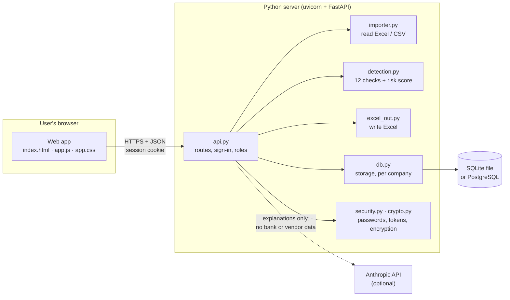
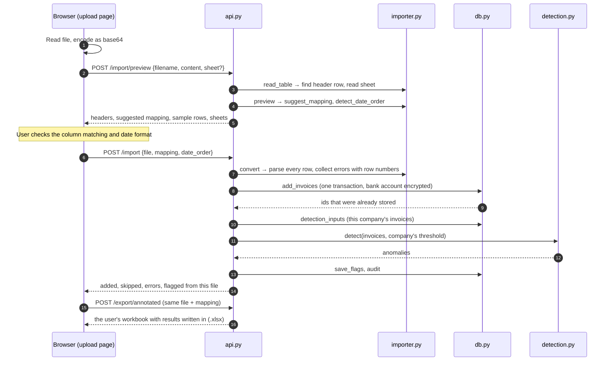
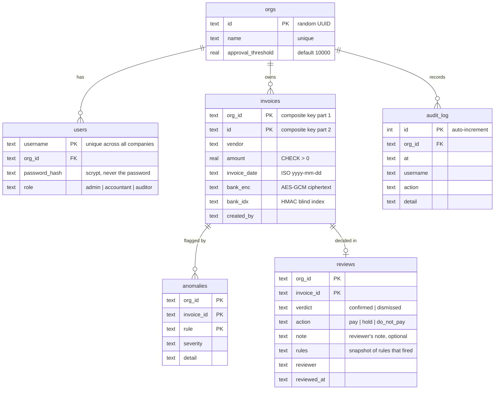
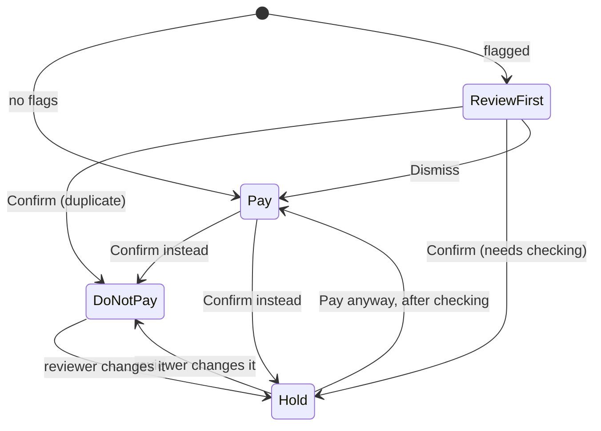
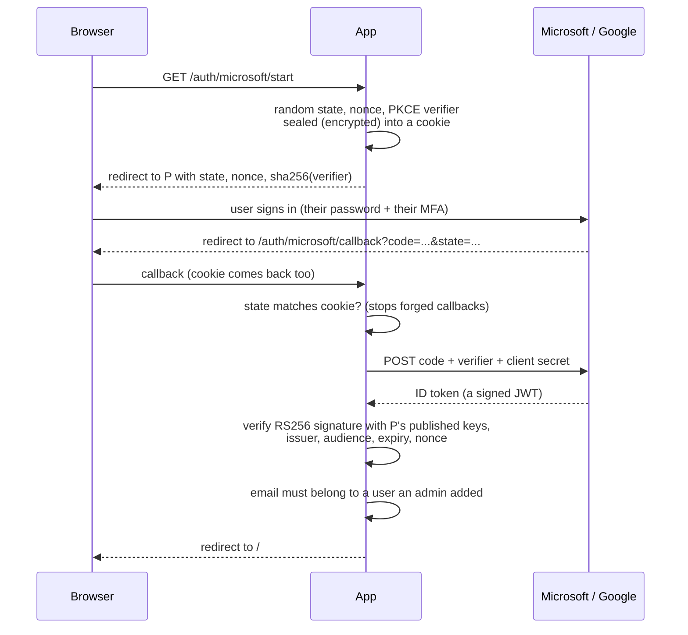
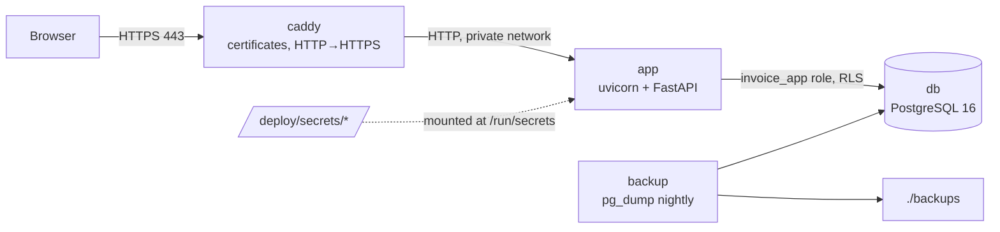
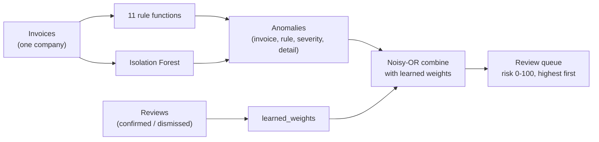
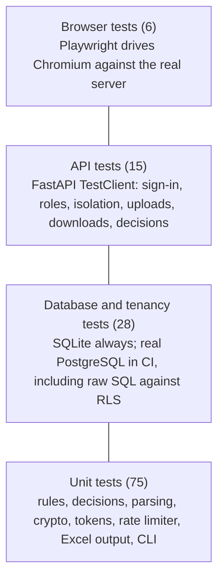

# How the Invoice Anomaly Detector works

A complete guide to the code: what each part does, how the parts fit together, and the
computer-science ideas behind them. It is written so you can explain the system to someone
else, from a one-minute summary down to individual algorithms.

**Contents**

1. [The one-minute version](#1-the-one-minute-version)
2. [System architecture](#2-system-architecture)
3. [A tour of the repository](#3-a-tour-of-the-repository)
4. [How data moves through the system](#4-how-data-moves-through-the-system)
5. [The data model](#5-the-data-model)
6. [Module by module](#6-module-by-module)
7. [The detection engine in depth](#7-the-detection-engine-in-depth)
8. [The security model](#8-the-security-model)
9. [Data structures used, and why](#9-data-structures-used-and-why)
10. [Algorithms and their cost](#10-algorithms-and-their-cost)
11. [How it is tested](#11-how-it-is-tested)
12. [Links to the Gleam course ideas](#12-links-to-the-gleam-course-ideas)
13. [How to explain it](#13-how-to-explain-it)
14. [Limits and what to build next](#14-limits-and-what-to-build-next)
15. [Glossary](#15-glossary)

---

## 1. The one-minute version

Companies pay suppliers by invoice, and some invoices are wrong: paid twice, sent to a
fraudster's bank account, split to dodge an approval limit, or simply far larger than usual.
This system reads a company's invoices (typically an Excel export from its accounting software),
runs **twelve checks** on them, and produces a **review queue** ranked by a 0–100 risk score, with
a plain-English reason for every flag. Accountants confirm or dismiss each flag. Confirming
sets what happens to the payment (**Do not pay** or **Hold**) and lists what to do next, and the
decisions also tune the scoring for that company. Results can be downloaded as the company's own
spreadsheet with the findings written in.

Many companies can share one installation. Each sees only its own data, and that separation is
enforced in three places: the login token, the application code, and the database itself.

Under the hood it is a **Python web service** (FastAPI) with a **browser front end** (plain
JavaScript), storing data in **SQLite** for a single machine or **PostgreSQL** in production.
Sensitive fields are encrypted, every query is parameterized, and 124 automated tests run on
every change, including a test that drives the app in a real browser.

Remember the core idea: **flags are signals for a human, not verdicts.** The system never
blocks a payment by itself, and it never edits or deletes an invoice. A person confirms the
problem, the payment decision follows, and the original record stays as the supplier sent it.

---

## 2. System architecture

### 2.1 Client and server

The system follows the **client–server** model. The *server* is a Python program that holds the
data and does the work. The *client* is the web page running in the user's browser, which only
displays information and sends requests. They talk over **HTTP**, the protocol every website
uses, exchanging **JSON** (a text format for structured data, such as
`{"invoice_id": "INV-7", "risk": 84}`).



Why split it this way? The browser can't be trusted (anyone can open the developer tools and
change it), so every rule that matters, such as who may see what, is enforced on the server.
The page is purely a convenience.

### 2.2 Layered architecture

Inside the server, code is organised in **layers**. Each layer only calls the one below it,
which keeps each piece small and replaceable.

| Layer | Files | Job | Knows about HTTP? | Knows about the database? |
|---|---|---|---|---|
| Presentation | `web/` | Draw pages, collect clicks | Calls it | No |
| API (interface) | `api.py`, `cli.py` | Turn requests into actions; check sign-in and roles | Yes | Through `db.py` only |
| Domain logic | `detection.py`, `importer.py`, `excel_out.py`, `evaluate.py` | The actual rules: parse files, find anomalies, write workbooks | No | No |
| Data access | `db.py`, `schema.py` | Store and fetch, scoped to one company | No | Yes |
| Infrastructure | `config.py`, `security.py`, `crypto.py` | Settings, passwords, tokens, encryption | No | No |

The most important consequence: **the detection engine has no idea the web exists.**
`detect()` takes a list of invoices and returns a list of anomalies. The same function is used
by the web API, the command-line tool, the evaluation harness and the tests. This is called
**separation of concerns**.

### 2.3 Functional core, imperative shell

A useful way to describe the design is *functional core, imperative shell*:

- The **core** (`detection.py`, most of `importer.py`, `excel_out.py`) is made of **pure
  functions**: same input, same output, no hidden state, nothing written anywhere. They are easy
  to test and reason about, and safe to run in parallel.
- The **shell** (`api.py`, `cli.py`, `db.py`) does the messy, effectful things: reading the
  network, writing to the database, checking the clock.

For example, `find_duplicates(invoices)` never touches the database. `api.py` fetches the
invoices, calls the pure function, and stores the result.

### 2.4 A stateless API

Each HTTP request carries everything the server needs to know who is asking: a signed token,
either in an **HttpOnly cookie** (the web app) or as a **bearer token** in the `Authorization`
header (programs). The server keeps no "session" in memory between
requests, so it could be restarted, or several copies run behind a load balancer, without
logging anyone out. (One exception, covered in [section 14](#14-limits-and-what-to-build-next):
the login rate limiter does keep in-memory state.)

### 2.5 Configuration from the environment

Secrets and settings come from **environment variables** (optionally loaded from a `.env` file
on a developer's computer), never from the code. Every setting can also be given as
`NAME_FILE=/path`, a file holding the value: that is how Docker, Kubernetes and the cloud
secrets managers hand secrets to a container without putting them in its environment. This is one of the "Twelve-Factor App" principles. The same code runs on
your laptop and in production, and only the environment differs. It also means secrets never end
up on GitHub; `.gitignore` excludes `.env`.

### 2.6 Multi-tenancy

A **tenant** is a customer organisation, here a company. This system uses the most common
multi-tenant pattern: a **shared database with a tenant column**. Every table has an `org_id`, and
every query filters by it. The alternatives are a separate database per company (strongest
isolation, hardest to operate) or a separate schema per company (in between).

Because one forgotten `WHERE org_id = ?` would leak data, isolation is enforced in layers. This
approach is called **defence in depth**:

1. The company's ID is inside the **signed token**, so a user can't claim another company.
2. **Every application query** filters by that ID.
3. On PostgreSQL, **row-level security** makes the database itself refuse other companies' rows,
   even if the application forgets the filter.
4. **Per-company encryption keys** mean one company's bank details can't be decrypted with
   another's key.

### 2.7 Running it: ASGI, uvicorn, Docker, CI/CD

- **FastAPI** is the web framework. It maps URLs to Python functions and validates input.
- **uvicorn** is the web server that runs it. It speaks **ASGI**, the standard interface between
  Python web apps and servers.
- `create_app` is an **application factory**: a function that builds the app on demand. Tests
  call it with a temporary database; production calls it with real settings.
- The **Dockerfile** packages the app and its dependencies into a container image that runs the
  same anywhere. It runs as a non-root user, and secrets are passed in at runtime, never baked in.
- **GitHub Actions** (`.github/workflows/ci.yml`) is the **CI pipeline** (continuous
  integration). On every push it lints the code and runs the tests on Linux, Windows, three
  Python versions, a real PostgreSQL server and a real browser, then builds the Docker image and
  starts the whole production stack (section 6.14).

---

## 3. A tour of the repository

```
src/invoice_detector/
  api.py         ~630 lines  Web API: every URL, roles, uploads, downloads, HTTPS enforcement
  web/app.js    ~1140 lines  The browser app (pages, sign-in, two-factor set-up, tables)
  web/app.css    ~250 lines  The look: layout, colours, dark mode, phone layout
  web/index.html   16 lines  The empty page that loads app.js and app.css
  db.py          ~450 lines  All database reads and writes, scoped to one company; key check
  importer.py    ~410 lines  Reads Excel/CSV, guesses columns, parses amounts and dates
  detection.py   ~390 lines  The 12 checks, the ML model, risk scoring, learning from reviews
  accounts.py    ~320 lines  Sign-in rules: passwords, two-factor, SSO, password reset
  excel_out.py   ~300 lines  Writes results into workbooks, reports, the template
  cli.py         ~260 lines  Command-line tool: init, init-deploy, migrate, create-org, import, ...
  qr.py          ~250 lines  QR code encoder (for the two-factor set-up screen)
  oidc.py        ~250 lines  Single sign-on: OpenID Connect with PKCE, ID-token checks
  schema.py      ~160 lines  Table definitions and PostgreSQL security policies
  samples.py     ~150 lines  Builds the four sample workbooks
  config.py      ~130 lines  Reads settings and secrets (variables or files)
  security.py    ~120 lines  Password hashing, rate limiting, signed tokens
  demo.py        ~110 lines  Synthetic invoices with planted problems
  totp.py        ~100 lines  Authenticator-app codes and recovery codes
  decisions.py    ~90 lines  Payment decision and next steps for each flagged invoice
  evaluate.py     ~80 lines  Measures precision and recall on synthetic data
  mailer.py       ~70 lines  Sends password-reset emails (SMTP, or a folder for testing)
  crypto.py       ~55 lines  AES-GCM encryption, per-company keys, blind index
  explain.py      ~50 lines  Optional plain-English summary via the Claude API
tests/                       ~175 automated tests (unit, API, database, browser)
samples/                     The four sample Excel files
docs/                        TUTORIAL.md, DEPLOYMENT.md and this guide
deploy/                      Caddyfile (HTTPS), entrypoint.sh (start-up), backup.sh
prototypes/                  The original Gleam version
.github/workflows/ci.yml     The CI pipeline
Dockerfile, docker-compose.yml (local database), docker-compose.prod.yml (production),
pyproject.toml, .env.example, .gitignore
```

`pyproject.toml` is the project's manifest: its name, version, the libraries it depends on
(FastAPI, uvicorn, cryptography, numpy, scikit-learn, openpyxl), optional extras (`dev`,
`postgres`, `e2e`) and tool settings. `pip install -e ".[dev]"` reads it.

---

## 4. How data moves through the system

### 4.1 Signing in

```mermaid
sequenceDiagram
    autonumber
    participant B as Browser
    participant A as api.py /login
    participant L as RateLimiter
    participant D as db.py
    participant S as TokenSigner
    B->>A: POST /login {username, password}
    A->>L: check("ip:username")
    alt 5 failures in 15 min
        L-->>A: RateLimitError
        A-->>B: 429 Too many attempts
    end
    A->>D: auth_lookup(username)
    D-->>A: {password_hash, role, org_id} or nothing
    A->>A: verify_password (scrypt, constant time)<br/>uses a dummy hash if the user doesn't exist
    alt wrong
        A->>L: record_failure
        A-->>B: 401 "Invalid credentials" (same message either way)
    else right
        A->>D: audit("login")
        A->>S: make(user, role, org, ttl=1 hour)
        S-->>A: base64(JSON) + "." + HMAC signature
        A-->>B: {access_token}
    end
    Note over B: The token arrives in an HttpOnly cookie the page<br/>can't read; the browser sends it on every request
```

That is the password path with two-factor off. With two-factor on, step "right" returns
`{mfa_required, mfa_token}` instead: a 5-minute token that only `POST /login/2fa` accepts, which
swaps it plus a 6-digit code for the real token. Single sign-on skips the password entirely: the
browser goes to Microsoft or Google and comes back with a one-time code the server exchanges for
a verified identity. Both are explained in [section 6.13](#613-sign-in-accountspy-totppy-qrpy-oidcpy-mailerpy).

### 4.2 Uploading a spreadsheet



Note that the server **never stores the uploaded file**. It is parsed, the clean invoices are
saved (with bank accounts encrypted), and the raw bytes are discarded. To return the annotated
workbook, the browser simply sends the file again, which it still holds in memory.

### 4.3 Reviewing a flag

1. The browser calls `GET /review-queue`.
2. The server loads this company's anomalies and reviews, computes **learned rule weights** from
   past reviews, combines each invoice's flags into a risk score, sorts, and adds vendor, amount
   and date.
3. The accountant clicks **Confirm** on a duplicate. The browser sends
   `POST /review/INV-0245 {"verdict": "confirmed"}`.
4. The server stores the verdict with a **snapshot of which rules fired**, and the **payment
   action** that follows: none was chosen, so `suggested_action(["duplicate"])` supplies
   `do_not_pay`. It writes an audit entry and returns the action, and the browser shows
   "Do not pay".
5. The accountant can then pick a different action (say, *Hold*) and add a note; that is the same
   request with `"action"` and `"note"` filled in. **Dismiss** stores the action `pay`.
6. Next time the queue is computed, every rule that fired on a dismissed invoice counts slightly
   less for this company, and confirmed ones keep their weight.
7. The payment file and the annotated workbook read the same decisions, so Excel always shows
   the latest outcome.

### 4.4 One request, end to end

What happens when the browser asks for `GET /invoices`:

1. **uvicorn** receives the HTTP request and hands it to FastAPI.
2. The **security-headers middleware** wraps the request so its response gets protective headers.
3. FastAPI matches the URL to `list_invoices`. Its parameter
   `user = Depends(current_user)` triggers **dependency injection**: FastAPI first runs
   `current_user`, which reads the `Authorization` header and verifies the token. A bad token
   stops here with **401**.
4. `list_invoices` calls `db.list_invoices(user["org"], sort, limit)`. It checks `sort` against an
   **allow-list**, opens a transaction scoped to the company, and runs a parameterized query.
5. Rows come back as Python dicts. FastAPI serializes them to JSON, and the middleware adds headers.
6. The browser receives the JSON and builds table rows with `textContent`, which can never run code.

---

## 5. The data model

The database is **relational**: data lives in tables of rows and columns, and tables refer to
each other by keys.



Concepts at work:

- **Primary key (PK):** what makes a row unique. `invoices` uses a **composite key**
  `(org_id, id)`, so two companies can both have an invoice called "INV-1". `anomalies` uses
  `(org_id, invoice_id, rule)`, so the same rule can't flag the same invoice twice.
- **Foreign key (FK):** a column that must match a row in another table. An anomaly can't point
  at an invoice that doesn't exist. SQLite enforces this only after `PRAGMA foreign_keys = ON`,
  which `db.py` sets.
- **CHECK constraints:** rules the database enforces on every write, such as `amount > 0` and
  `role IN ('admin', 'accountant', 'auditor')`. Even buggy code can't store a negative invoice.
- **Normalization:** each fact is stored once. The company name lives only in `orgs`, and other
  tables refer to it by `org_id`.
- **Derived data:** `anomalies` can always be recomputed from `invoices`, and `save_flags` simply
  replaces them. `reviews` are human decisions and are kept, so they survive re-runs.
- **Upgrading old databases:** the `action` and `note` columns were added after the first
  release. `schema.py` lists them in `ADDED_COLUMNS`. On start-up, SQLite files from older versions
  get them with `ALTER TABLE ... ADD COLUMN`, and on PostgreSQL `migrate` uses
  `ADD COLUMN IF NOT EXISTS`. Existing data is kept. This is a **schema migration**: changing the
  shape of stored data without losing it.
- **One schema, two databases:** `schema.py` writes the table definitions once with placeholders
  such as `{REAL}`, then fills them in for SQLite (`REAL`) and PostgreSQL (`DOUBLE PRECISION`).

---

## 6. Module by module

### 6.1 `config.py`: settings and secrets

- `load_dotenv` reads `KEY=value` lines from `.env` into the environment, but **real environment
  variables win** (`os.environ.setdefault`). It detects UTF-16 files by their **byte-order mark**
  (BOM), the first bytes `FF FE`, because Windows PowerShell's `>` writes UTF-16. This was a real
  bug you hit.
- `Settings` is a **frozen dataclass**: an immutable record. Secret fields are declared with
  `repr=False`, so printing or logging the settings object never reveals them.
- `Settings.from_env` **validates early**: a missing key or a too-short secret stops the program
  at start-up with a clear message, instead of failing mysteriously later. This is the
  **fail-fast** principle.
- `parse_keys` reads `ENCRYPTION_KEYS="1:<base64>,2:<base64>"`, a numbered key list that makes
  key rotation possible ([section 8](#8-the-security-model)).
- `env(name)` returns `NAME` if set, otherwise the contents of the file named by `NAME_FILE`
  (trailing newline stripped). Every secret goes through it, so secrets managers that mount
  files and ones that set variables both work.
- Settings for hosting and sign-in: `PUBLIC_URL` (the address used in emailed links and SSO
  redirects), `FORCE_HTTPS`, `SMTP_*` / `MAIL_FROM` / `MAIL_DIR`, and the SSO providers, parsed by
  `oidc.providers_from_env`.

### 6.2 `security.py`: passwords, rate limiting, tokens

**Password hashing.** Passwords are never stored. `hash_password` stores
`scrypt$N$r$p$salt$digest`:

- **scrypt** is a deliberately slow, memory-hungry **key derivation function**. With
  `N = 2^14, r = 8, p = 1`, each guess costs about 16 MB of memory, which cripples attackers who
  try billions of guesses on graphics cards.
- A random 16-byte **salt** per user means two people with the same password get different
  hashes, and precomputed "rainbow tables" are useless.
- The cost parameters are stored inside the hash, so they can be raised later without breaking
  old hashes.
- `verify_password` uses `hmac.compare_digest`, a **constant-time comparison**. A normal `==`
  stops at the first differing character, and an attacker measuring response times could learn
  how many characters matched. This is called a **timing attack**.
- `DUMMY_HASH`: when a username doesn't exist, login still runs a full scrypt check against a
  dummy hash, so "no such user" and "wrong password" take the same time and return the same
  message. This prevents **user enumeration**.

**Rate limiting.** `RateLimiter` implements a **sliding window**:

- A `dict` maps each key (`"ip:username"`) to a `deque` (double-ended queue) of failure
  timestamps.
- On each failure, the new time is appended on the right, and timestamps older than the window
  (15 minutes) are popped off the left. A deque makes both ends O(1).
- If 5 failures remain in the window, the key is locked for 15 minutes.
- Keying by IP *and* username means an attacker can't lock everyone out from one address, and
  can't hammer one account from many addresses without each address being limited.
- Methods take an optional `now` argument. This is **dependency injection of time**: tests pass
  fake timestamps instead of waiting 15 real minutes.

**Signed tokens.** `TokenSigner` makes tokens in the style of a JWT (JSON Web Token):

```
eyJzdWIiOiJhbGljZSIsInJvbGUiOiJhZG1pbiIs...  .  q0Rk3...
└──── base64url(JSON: sub, role, org, exp) ──┘     └── HMAC-SHA256 of the first part ──┘
```

- **HMAC-SHA256** is a keyed hash. Only someone with `SECRET_KEY` can produce a valid signature,
  so changing even one character of the body (say, `"role":"auditor"` to `"admin"`, or another
  company's ID) makes the signature check fail. A test does exactly this.
- The body is readable (base64 is encoding, not encryption), so tokens contain no secrets.
- `exp` makes tokens **expire** after an hour.
- Each token has a **purpose** (`access`, `mfa`, `reset`). `verify(token, purpose)` rejects a token
  made for a different purpose, so a half-finished sign-in token or a password-reset link can
  never be used as a session.
- The signature is checked with math alone, but `accounts.authenticate` then does one cheap
  database lookup per request: the user must still exist, in the same company, and the token's
  `pwf` (a 16-character fingerprint of the password hash) must match. Changing or resetting a
  password changes the fingerprint, which **ends every existing session** at once, without a
  session table.

### 6.3 `crypto.py`: encrypting bank details

**AES-256-GCM** is the encryption. GCM is an **AEAD** cipher (authenticated encryption with
associated data), which gives you three things at once:

1. **Confidentiality:** the ciphertext reveals nothing about the account number.
2. **Integrity:** any change to the ciphertext makes decryption fail. You can't tamper with it.
3. **Associated data:** extra text that isn't encrypted but is checked. Here it is the
   **context** `invoices.bank:<org>:<invoice id>`. If someone copies one row's ciphertext into
   another row or company, decryption fails, because the context no longer matches.

Each encryption uses a fresh random 12-byte **nonce** (a number used once), so encrypting the same
account twice gives different results. Reusing a nonce with the same key would be catastrophic
for GCM, which is why it's always random.

Stored format: `"<key id>:<base64(nonce + ciphertext + tag)>"`. The **key ID** enables
**key rotation**: add key 2, new data uses key 2, old data still decrypts with key 1, and
`rotate()` re-encrypts old values.

**Per-company keys.** `Vault.for_org` derives each company's keys from the master keys with
**HKDF** (HMAC-based Key Derivation Function), using the company ID as input. One master key
produces an unlimited family of unrelated keys, so there is nothing extra to store, and company
A's data can't be decrypted with company B's derived key.

**Blind index.** Encrypted values can't be compared: two encryptions of the same account look
different. Yet detection needs to know whether two invoices pay the same account. The solution
is a **blind index**: `HMAC(index_key, normalized account)`. It is deterministic (same account,
same index), can't be reversed without the key, and reveals only equality. Detection runs
entirely on blind indexes and never decrypts an account. The account is normalized first
(spaces removed, upper-cased), so `de89 3704` and `DE893704` match.

### 6.4 `schema.py` and `db.py`: storage

**The connection layer.** `Database` opens either SQLite (a single file, built into Python) or
PostgreSQL (a database server, via `psycopg`), depending on the URL. It exposes ordinary methods
such as `add_invoices`, `list_anomalies` and `set_review`, so no other module writes SQL. This is
the **repository pattern**: callers ask for data in domain terms, and the SQL details stay in one
place.

**Transactions.** `_tx(org_id)` is a **context manager** (used with `with`). Everything inside one
`with` block is a single **transaction**: it all happens or none of it does (**atomicity**). If
the 120th row of an import breaks a constraint, the whole batch is rolled back, so you never get a
half-imported file. Inside, it:

- takes a **lock** (`threading.RLock`), because one connection is shared between threads and two
  requests mustn't interleave on it;
- on PostgreSQL, runs `set_config('app.org_id', <company>, true)`. The `true` makes the setting
  **local to this transaction**, so one request's company can never leak into the next;
- translates the database driver's integrity errors into one `Conflict` exception, which the API
  turns into HTTP **409**. The rest of the code never needs to know which database is in use;
- yields a small `run(sql, params)` helper that converts SQLite's `?` placeholders into
  PostgreSQL's `%s` and returns rows as dicts.

**Parameterized queries.** Every value goes into SQL as a parameter:

```python
run("SELECT ... FROM invoices WHERE org_id = ? AND id = ?", (org_id, inv_id))
```

The database receives the SQL text and the values separately, so a value like
`x' OR '1'='1` is just a strange invoice number, never part of the command. This prevents
**SQL injection**. Column names can't be parameters, so the sort column is checked against
`SORTABLE = {"id", "vendor", "amount", "invoice_date"}` (an **allow-list**) before being placed
in the SQL.

**Upserts.** `ON CONFLICT (org_id, id) DO NOTHING` inserts a row unless it exists. `rowcount`
then tells us whether it was new, which is how import reports "already stored". Reviews use
`ON CONFLICT ... DO UPDATE` so changing your mind overwrites the old verdict.

**Batching.** `get_invoices` looks up IDs in chunks of 500 with `id IN (?, ?, ...)`, generating
one placeholder per value. It stays parameterized and stays under database limits on the number
of parameters.

**Row-level security (PostgreSQL only).** `schema.py`'s `POSTGRES_SECURITY` script:

- creates a limited role `invoice_app` for the web server: not a superuser, and it can't bypass
  RLS, create databases or create roles;
- defines `app_org_id()`, which reads the transaction's `app.org_id` setting;
- turns on RLS for every table and adds a `tenant_isolation` policy:
  `USING (org_id = app_org_id()) WITH CHECK (org_id = app_org_id())`. `USING` filters what can
  be read, updated or deleted; `WITH CHECK` validates what can be written. With no company set,
  `app_org_id()` is NULL, nothing matches, and every table looks empty;
- applies **least privilege**: the app role can't create companies, can't update or delete
  invoices, and can only read and *add to* the audit log, so the trail is **append-only**;
- provides `auth_lookup`, a `SECURITY DEFINER` function. Login has to find a user *before* the
  company is known, so this one narrow function runs with the owner's rights and returns just the
  fields login needs. Everything else stays behind RLS.

`migrate()` runs this script. It is **idempotent** (`IF NOT EXISTS`, `DROP POLICY IF EXISTS`),
so it's safe to run on every deploy.

### 6.5 `importer.py`: reading messy spreadsheets

This is a **parsing pipeline**: raw bytes → table → clean invoices + error list.

1. **Decoding** (CSV): text files can be UTF-8, UTF-16 (with a BOM) or old Windows code page
   1252. `_decode` tries them in a sensible order.
2. **Delimiter sniffing:** `csv.Sniffer` guesses whether columns are separated by `,`, `;`
   (common in Europe, where `,` is the decimal mark), tab or `|`.
3. **Excel reading:** `openpyxl` opens .xlsx in **read-only, streaming mode** (low memory) and
   `data_only=True` (formula *results*, not formulas). `_read_xlsx` finds every sheet containing a
   table, preferring the active sheet, and the caller can pick a sheet.
4. **Header detection:** real exports have report titles above the header row. `_find_header`
   scores each of the first 15 rows by how many cells match known column names, and picks the
   best. This is a simple **heuristic** (a rule of thumb that is usually right, and correctable by
   the user).
5. **Column mapping:** `suggest_mapping` normalizes headers (`"Invoice #"` → `"invoice"`), then
   matches them against a **synonym dictionary** in two passes: exact matches first, then
   "contains" matches using the longest synonyms first. Each header can be used once. This is a
   **greedy** matching algorithm.
6. **Value parsing:**
   - `parse_amount` strips currency symbols and codes, handles `(12.00)` as negative, and decides
     the decimal separator. If both `,` and `.` appear, the last one is the decimal point
     (`1.234,56` vs `1,234.56`). A lone comma is a thousands separator only in the pattern
     `1,234` or `1,234,567`; otherwise it's a decimal comma. Non-positive amounts are rejected.
   - `parse_date` accepts real Excel dates, Excel **serial numbers** (days since 30 Dec 1899),
     ISO dates, numeric dates in either order, and text such as "5 Mar 2026".
   - `detect_date_order` resolves `03/05/2026`. If any first number is over 12 the file is
     day-first; if any second number is over 12 it's month-first; if neither, the order is
     reported as **ambiguous** and the user must choose. **The system never silently guesses
     where a wrong guess would corrupt data.**
7. **Validation and errors:** `convert` checks each row and records failures with the
   **spreadsheet row number** and a human-readable message. Blank and totals rows are skipped and
   counted. It also records `lines` (invoice ID → row number), which `excel_out` later uses to
   write results back onto the right row.

`Table` and `Converted` are **dataclasses**: simple record types that group related values with
names and types.

### 6.6 `excel_out.py`: writing results into workbooks

- `annotate` opens the user's own workbook, finds the last used column, and adds six columns:
  Risk, Review status, Payment decision, Flags, Why flagged and What to do. It fills them in using
  the `lines` map, adds a ranked **Flagged invoices** sheet and an **About these flags** sheet,
  and saves to bytes in memory. CSV uploads are first rebuilt as a worksheet.
- `payment_file` sorts **every** invoice (not just flagged ones) by payment decision into sheets
  (Ready to pay, Review first, On hold, Do not pay) with totals and a summary. This is the
  "corrected" output: nothing in the invoices changes, but the batch to pay is now clean.
- **It never changes an existing cell**, so the user's data and formulas survive. `.xlsm` files
  keep their macros (`keep_vba=True`).
- **Formula injection** (also called CSV injection): if a vendor name is `=HYPERLINK(...)` and you
  write it into a cell, Excel treats it as a formula when the file is opened, which can leak data
  or mislead the reader. `safe()` prefixes such text with `'`, and `put()` forces the cell type to
  string. A test scans every written cell to prove none became a formula.
- `review_report` and `template` build new workbooks from scratch.

### 6.7 `api.py`: the web API

**Routes** map HTTP methods and paths to functions. The full list:

| Method and path | Who | Purpose |
|---|---|---|
| `GET /` and `/app/{file}` | anyone | The web app's three files |
| `GET /health` | anyone | "Am I running?" check for monitoring |
| `GET /samples`, `/samples/{name}` | anyone | Sample workbooks (synthetic) |
| `POST /login` | anyone | Password → token (rate limited) |
| `GET /me` | signed in | Who am I, which company |
| `GET`, `POST /users` | admin | List or add people in your company |
| `GET` / `PUT /settings` | signed in / admin | Approval threshold |
| `GET /audit` | admin, auditor | Activity log |
| `POST /invoices`, `/invoices/bulk` | admin, accountant | Add one or up to 1,000 invoices |
| `GET /invoices` | signed in | List (never includes bank data) |
| `GET /invoices/{id}/bank` | admin | Decrypt one bank account (audited) |
| `POST /import/preview`, `/import` | admin, accountant | Read a file, suggest mapping; import |
| `POST /detect` | admin, accountant | Run all checks |
| `GET /anomalies` | signed in | Every individual flag |
| `GET /review-queue` | signed in | Ranked flags with reasons and status |
| `POST /review/{id}` | admin, accountant | Confirm or dismiss; optional payment action and note |
| `GET /metrics`, `/summary` | signed in | Accuracy per rule; dashboard numbers |
| `POST /export/annotated`, `GET /export/review.xlsx`, `GET /export/payment-file.xlsx` | signed in | Excel downloads |
| `POST /explain` | signed in | Plain-English summary |

Concepts used:

- **REST-style design:** resources (invoices, users, settings) addressed by URL, and HTTP
  methods for intent: `GET` reads, `POST` creates or acts, `PUT` replaces.
- **HTTP status codes** carry meaning: 200 OK, 201 Created, 401 not signed in, 403 signed in but
  not allowed, 404 not found, 409 conflict (already exists), 413 too large, 422 invalid input,
  429 too many attempts.
- **Validation with Pydantic models:** `InvoiceIn` declares `amount: float = Field(gt=0, lt=1e12)`
  and an ID pattern. FastAPI checks every request against the model before your code runs, and
  rejects bad input with 422. This is **input validation at the boundary**.
- **Dependency injection** with `Depends`: `current_user` verifies the token, and `require("admin")`
  is a **higher-order function** (a function that returns a function) producing a dependency that
  also checks the role. Writing `user = Depends(require("admin", "accountant"))` on a route is a
  declarative, one-line access rule. This is **role-based access control (RBAC)**.
- **Closures:** `create_app` defines all routes inside itself, so they "close over" the `db`,
  `signer` and `limiter` created there, with no global variables. That's why tests can create
  isolated apps.
- **Middleware:** `security_headers` wraps every request and response. Before the route runs it
  refuses cross-site requests (below). On the way out it adds headers that stop browsers guessing
  content types (`X-Content-Type-Options`), stop the site being framed (`X-Frame-Options`,
  clickjacking), switch off camera, microphone and location (`Permissions-Policy`), isolate the
  window from other sites (`Cross-Origin-Opener-Policy`), give the web app a strict
  **Content-Security-Policy** and API answers `default-src 'none'`, and mark API answers
  `Cache-Control: no-store` so company data isn't kept in caches ([section 8](#8-the-security-model)).
- **Browser sessions and CSRF:** after sign-in, the token is put in a cookie that is
  `HttpOnly` (page scripts can't read it, so even an injected script couldn't steal it), `Secure`,
  `SameSite=Strict`, and named with the `__Host-` prefix (browsers then insist on HTTPS, this exact
  host, every path). Cookies bring one classic risk, **cross-site request forgery**: another site
  making your browser send a request here, cookie attached. Three locks: SameSite=Strict; any
  change signed only by the cookie must carry an `X-Requested-With: fetch` header, which another
  site can't add; and a request whose `Origin` is another site is refused. Programs keep using
  `Authorization: Bearer`, which can't be forged this way.
- **Strict request bodies:** every input model refuses unknown fields (`extra="forbid"`). A
  request that adds `"org_id"` or `"role"` hoping some code path reads it gets 422, not silence.
- **`BodyLimit`:** a small ASGI wrapper that refuses bodies over 16 MB (413) or without a length
  (411) before anything reads them, so no one can make the server buffer gigabytes.
- **Exceptions mapped to responses:** domain errors (`FileProblem`, `KeyError`, `Conflict`)
  become `HTTPException` with the right status, at the edge of the system.
- **File transfer:** uploads arrive as base64 inside JSON, which is simple and avoids an extra
  dependency, at the cost of about 33% size overhead. Downloads are raw bytes with a
  `Content-Disposition: attachment` header; `attachment()` sanitizes the filename so a malicious
  name can't inject extra headers.
- **Audit logging:** sensitive actions (login, import, detection, review, viewing a bank
  account, exports) are recorded with who and when.

### 6.8 `cli.py`: the command line

A small **command dispatcher**: `main(argv)` looks at the first word (`init`, `create-org`,
`import`, `detect`, ...) and calls the matching function. It returns **exit codes** (0 for
success, 1 for failure), the Unix convention scripts rely on. `_db()` is a context manager that
always closes the database, even on errors. The CLI uses the database *owner* connection, because
operators need to create companies, which the web server's limited role can't do.
`reset-password NAME` sets a new password for a user who forgot theirs. `init-deploy DIR` writes
one file per production secret (with matching database passwords, permissions `600`, never
overwriting). Every command except `migrate` first runs `db.check_keys()`; `run(argv)` turns a
configuration problem such as wrong keys into a one-line message and exit code 2.

### 6.9 `decisions.py`: what to do about a flag

A small, pure module that answers two questions for a flagged invoice:

- **What should happen to the payment?** `RULE_FIX` maps each rule to a suggested action and a
  plain-English next step. `suggested_action(rules)` picks the **strictest** action among the rules
  that fired (`do_not_pay` beats `hold`), a simple *max by severity*.
- **What is the decision right now?** `payment_decision(item)` is a small **state machine** over
  the review status:



**Design choice: it never edits invoices.** "Fixing" a duplicate means not paying it, and fixing a
suspicious bank change means calling the vendor; neither is a data edit. Invoices are immutable,
so the audit trail always shows what the supplier actually sent, and decisions live separately
in `reviews`. This is the **event / decision log** idea used in accounting systems: you record
what was decided, you don't overwrite what happened.

### 6.10 `explain.py`: optional AI summary

Builds a prompt containing **only invoice IDs, rule names and numbers**, with no vendor names or
bank details (**data minimization**), and calls the Anthropic Messages API. The HTTP function is
a parameter (`post=_default_post`), so tests pass a fake and never touch the network. Any failure
(no key, network down, bad response) falls back to a plain template: **graceful degradation**.
The model name in this file should be checked against Anthropic's current docs.

### 6.11 `demo.py`, `evaluate.py`, `samples.py`: data for testing and demos

- `demo.py` generates **synthetic invoices**: eight vendors with realistic amounts drawn from a
  **log-normal distribution** (amounts are skewed: many ordinary, a few large), regular invoice
  cadences, one fixed-price subscription, and 14 **planted anomalies** of known types. A
  **random seed** makes it **reproducible**: seed 0 always produces the same data.
- `evaluate.py` runs detection on 10 seeds and measures quality ([section 7.7](#77-measuring-quality)).
- `samples.py` reshapes the demo data into four realistic workbook styles. Timestamps inside the
  files are fixed, so the output is deterministic.

### 6.12 `web/`: the browser app

It is a **single-page application** (SPA): the browser loads one page once, and JavaScript
redraws the content as you navigate. There is no framework, just about 760 lines of plain
JavaScript.

- **Hash routing:** the part of the address after `#` (`#/review`) selects the page. Changing it
  fires a `hashchange` event, and `render()` draws the matching page from the `PAGES` table. This
  is a **dispatch table**: data that maps names to functions. Pages a role can't use are left out
  of the table lookup, so typing `#/upload` as an auditor redirects to the dashboard (the server
  would refuse the request anyway).
- **`h(tag, props, ...children)`** is a tiny **hyperscript** helper that builds DOM elements
  (the browser's in-memory tree of the page) from nested calls, in the same spirit as React's
  `createElement`.
- **XSS safety:** text from the server is inserted with `textContent` and `createTextNode`, never
  `innerHTML`. A vendor named `` is shown as those characters, not run.
  This prevents **cross-site scripting (XSS)**, and an automated test checks that `innerHTML`
  never appears in the code.
- **async/await and fetch:** network calls are **asynchronous**, so the page stays responsive
  while waiting. `api()` wraps `fetch`, adds the token, and turns errors into readable messages.
  A 401 signs you out.
- **Race-condition guard:** `render()` increments `renderToken`. If you click two pages quickly,
  the slower response checks that its token is still current before drawing, so an old page can
  never overwrite a newer one.
- **State in closures:** each page keeps its state (current tab, search text, review counts) in
  local variables captured by its event handlers, instead of in globals.
- **Storage:** the sign-in token is in an HttpOnly cookie the script never sees; on start-up
  the app asks `GET /me` who is signed in. Saved column mappings live in `localStorage`, keyed by the file's header row. Every access is wrapped
  in `try/catch`, because storage can be unavailable.
- **Downloads:** the browser fetches the file with the token, turns it into a **Blob**, creates
  a temporary object URL, and clicks a hidden `<a download>` link.
- **Uploads:** `FileReader` / `arrayBuffer()` reads the file, and `toBase64` encodes it in 32 KB
  chunks (encoding all at once can overflow the call stack on big files).
- **CSS:** design tokens as **CSS custom properties** (`--brand`, `--red`, ...), redefined for
  dark mode with `prefers-color-scheme`; **CSS Grid** for layout; a **media query** at 860 px
  that turns the sidebar into a top bar and the review table into stacked cards on phones.
- **Accessibility:** form labels, `aria-label` on icon-like buttons, `aria-current` for the
  active page, keyboard-operable rows (Enter or Space expands), and visible focus outlines.

---

### 6.13 Sign-in: `accounts.py`, `totp.py`, `qr.py`, `oidc.py`, `mailer.py`

`accounts.py` is the **sign-in service**: every rule about who may sign in and how lives here,
as plain Python methods (`login`, `login_second_factor`, `authenticate`, `enable_2fa`,
`forgot_password`, `sso_callback`, ...). `api.py` only turns HTTP into calls and errors
(`AccountError(status, message)`) back into HTTP. Keeping the logic out of the web framework is
the **thin controller** pattern: the tests in `test_accounts.py` exercise every rule without
starting a server.

**Two-factor authentication (`totp.py`).** TOTP, RFC 6238, the algorithm in every
authenticator app:

1. When you turn it on, the server makes a random 160-bit **shared secret** and shows it as a QR
   code. Your phone stores it. (On the server it is encrypted like a bank account.)
2. Both sides compute `step = floor(unix_time / 30)`, then `HMAC-SHA1(secret, step)`, take 4 bytes
   from a position given by the last byte (**dynamic truncation**), and keep the last 6 digits.
3. Same secret + same clock = same code, with nothing sent over the network.

`verify` accepts the step before and after too (phones' clocks drift), and stores the last step
used (`totp_last_step`): a code that was already used, even within its 30 seconds, is refused.
That is **replay protection**. **Recovery codes** are ten random one-time codes; only their
HMAC (keyed with the server secret, a **pepper**) is stored, and each is deleted once used.

**QR codes (`qr.py`).** The QR code is drawn by the app itself rather than a library or an
online service, so the secret never leaves the server and the page needs no third-party script
(the CSP stays strict). It is a complete encoder for what's needed: byte mode, error-correction
level M, versions 1–10. The interesting parts: **Reed–Solomon error correction** (polynomial
division over the finite field GF(256), so a scratched code still scans), the fixed patterns
(finders, timing, alignment), and trying all **eight masks** and keeping the one with the lowest
penalty score, which avoids patterns that confuse cameras. A test decodes 320 generated codes
with OpenCV to prove they read back correctly.

**Single sign-on (`oidc.py`).** OpenID Connect, the standard behind "Sign in with Microsoft /
Google", using the **authorization code flow with PKCE**:



- **state** ties the callback to the browser that started it; **nonce** ties the ID token to this
  attempt; **PKCE** means an intercepted `code` is useless without the verifier only the server
  holds.
- Keys are fetched from the provider's **JWKS** URL found by **discovery**
  (`/.well-known/openid-configuration`) and re-fetched when an unknown key ID appears, so the
  provider can rotate its keys.
- Microsoft must be configured with your own tenant ID; multi-tenant endpoints are refused, so
  a stranger with any Microsoft account can't get in.
- SSO never creates accounts: the email must match a username an admin added. Sign-ins through
  SSO count as two-factor, because the provider handles that.
- Network calls (`get_json`, `post_form`) are passed in, so tests run against `tests/fake_idp.py`
  and the browser test against a small fake provider server, with real RSA signatures.

**Password reset (`mailer.py`).** `forgot_password` makes a 30-minute token with purpose `reset`
that also carries the current password fingerprint, so it stops working as soon as it's used
(the password, and so the fingerprint, changes). The mailer is chosen from settings: SMTP, a
folder of `.eml` files (`MAIL_DIR`, for testing), or none. The reply is identical whether the
account exists or not, and requests are rate limited.

### 6.14 Hosting: `Dockerfile`, `docker-compose.prod.yml`, `deploy/`

The production stack is four containers on a private network ([DEPLOYMENT.md](DEPLOYMENT.md)):



- **TLS termination at a reverse proxy.** Caddy holds the certificate (obtained and renewed
  automatically with the ACME protocol from Let's Encrypt) and forwards plain HTTP to the app
  over the private network. uvicorn runs with `--proxy-headers`, trusting `X-Forwarded-For` and
  `X-Forwarded-Proto` only from allowed addresses, so the rate limiter sees real client IPs and
  the app knows the request was HTTPS.
- **HTTPS enforcement** in `api.py`: with `FORCE_HTTPS=1`, any plain-HTTP request is redirected
  (308) and every response carries **HSTS** (`Strict-Transport-Security`), which tells browsers
  to refuse plain HTTP for this site for a year. `/health` is exempt so internal checks work.
- **Docker secrets:** each secret is a file mounted at `/run/secrets/NAME` and read through
  `NAME_FILE`, so it never appears in `docker inspect` or the process environment.
- **Start-up** (`deploy/entrypoint.sh`): run `migrate` (idempotent: it only adds what's missing)
  and the key check, then `exec uvicorn` so uvicorn receives stop signals directly.
- **Key check** (`db.check_keys`): the first start stores a value encrypted with the keys in the
  `meta` table (a **canary**). Every later start decrypts it; wrong keys stop the app before it
  writes anything unreadable.
- **Health checks:** `/health` (process is up) and `/health/ready` (database answers). Docker's
  `HEALTHCHECK` and cloud load balancers use the second.
- **Backups** (`deploy/backup.sh`): `pg_dump --format=custom`, written to a `.partial` file and
  renamed only when complete (so a crash never leaves a half backup that looks whole), old files
  deleted after 14 days. Restoring is `pg_restore --clean` followed by `migrate`, which re-applies
  the role permissions and policies. The keys are deliberately **not** in the backups.

## 7. The detection engine in depth

### 7.1 The pipeline



Each rule is an independent pure function `invoices → list of Anomaly`. `detect()` concatenates
their outputs and sorts by severity. Rules don't know about each other, so adding a rule means
writing one function and adding one line. That makes the engine **open for extension**.

All thresholds live in one frozen dataclass, `DetectionConfig` (approval threshold 10,000,
near-duplicate window 10 days, split window 3 days, outlier z 4.0, and so on). There are no
magic numbers scattered through the code, and the approval threshold is overridden per company.

### 7.2 The rules

| Rule | How it works | Data structure / technique | Weight |
|---|---|---|---|
| `duplicate` | Same vendor + amount + date as an earlier invoice | Hash map keyed by the tuple `(vendor, amount, date)`; one pass after sorting by date | 0.80 |
| `bank_account_change` | Established vendor (3+ invoices) paid to an account it has never used | Per-vendor `Counter` of blind indexes, walked in date order | 0.80 |
| `shared_bank_account` | One account used by two or more vendors; flags the minority vendor | Nested `defaultdict`: account → vendor → invoices | 0.70 |
| `amount_outlier` | Far above this vendor's history | Robust z-score on log amounts (below) | 0.55, or 0.75 if extreme |
| `split_invoice` | 2+ invoices within 3 days, each under the approval limit, together over it | Sliding window with two pointers over date-sorted invoices | 0.50 |
| `near_duplicate` | Same vendor + amount, 1–10 days apart | Group by `(vendor, amount)`, compare neighbours with `zip(group, group[1:])` | 0.50 |
| `similar_vendor_name` | Names ≥ 85% similar, e.g. "Acme Supplies" / "Acme Suppiles" | `difflib.SequenceMatcher` similarity ratio on normalized names, all pairs | 0.50 |
| `new_vendor_large` | Vendor with ≤ 2 invoices billing over 5× the overall median | Grouping + median | 0.40 |
| `ml_outlier` | Unusual combination of features | Isolation Forest (below) | 0.35 |
| `below_threshold` | Within 5% under the approval limit | Simple range check | 0.20 |
| `round_amount` | Multiple of 1,000, at least 1,000 | Modulo | 0.15 |
| `weekend_invoice` | Dated Saturday or Sunday | `date.weekday()` | 0.10 |

Why a monthly subscription doesn't trigger `near_duplicate`: the same amount from the same vendor
30 days apart is outside the 10-day window. A test checks exactly this.

### 7.3 Robust statistics for unusual amounts

A naive outlier test compares an amount with the vendor's **mean** and **standard deviation**.
That has a flaw: one enormous invoice inflates both, so it partly hides itself. This code uses
**robust statistics** instead:

1. Take the **logarithm** of amounts. Money is multiplicative ("3× bigger" matters more than
   "+300"), and logs turn ratios into differences.
2. Use the **median** (middle value) instead of the mean, and the **MAD** (median absolute
   deviation from the median) instead of the standard deviation. A single extreme value barely
   moves either.
3. Robust z = `0.6745 × (log(amount) − median) / MAD`. The constant 0.6745 rescales MAD so the
   result is comparable with an ordinary z-score.
4. The MAD is **floored at 0.05**, so a vendor who always bills exactly the same amount doesn't
   flag a 2% change.
5. Flag if z > 4 (above 8 is "high"), and only for vendors with at least 8 invoices: too little
   history means no reliable baseline.

A test feeds ten ~100 invoices and one of 50,000, and checks that only the big one is flagged.

### 7.4 Isolation Forest (the machine-learning part)

**Idea:** anomalies are *few and different*, so they're easy to separate from the rest.

1. Build a random **binary tree**: pick a random feature and a random split value, divide the
   data, and repeat on each side until each point is alone.
2. An ordinary point sits in a dense crowd and needs many splits to isolate. An anomaly is
   isolated in just a few. So **short average path length = anomalous**.
3. Build 300 such trees (a **forest**) on random sub-samples and average the path lengths into a
   score.

This is **unsupervised learning**: it needs no labelled examples of fraud, which most companies
don't have.

**Features** (`ml_features`), one row per invoice:

| Feature | Why |
|---|---|
| log(1 + amount) | Size, on a sensible scale |
| robust z vs the vendor's history (clipped to ±10) | Unusual *for this vendor* |
| weekend flag (0/1) | Timing |
| day of month | Billing patterns |
| log(1 + days since the vendor's previous invoice) | A burst of invoices is unusual |
| log(1 + vendor's invoice count) | New vendors behave differently |

Turning raw data into informative numbers like these is called **feature engineering**, and it
matters more than the choice of model.

**Choosing the cut-off.** Many implementations flag a fixed share, say "the top 3%", which
*forces* flags even on clean data. Here the cut-off is **data-driven**: flag scores above
`median + 6 × MAD` of all scores. Clean data produces few or no ML flags.

`random_state=0` and sorting invoices by ID make results **deterministic**: the same data always
gives the same flags, which matters for audits and tests. scikit-learn is optional at runtime: if
it's missing, the ML rule returns nothing and everything else still works.

### 7.5 Combining signals: the risk score

An invoice may trip several rules. How do you combine, say, "round amount" (weak) and "new bank
account" (strong)? Adding weights could exceed 100%, and taking the maximum ignores corroborating
evidence. This code uses a **noisy-OR**, a standard model from probabilistic reasoning:

```
risk = 1 − Π (1 − weightᵢ)        (over every rule that fired)
```

Read each weight as "the chance this signal alone means a real problem". The risk is then the
chance that *at least one* signal is right, if they were independent. Properties:

- one signal of 0.80 gives 80; two of 0.50 give 75; weak signals add up;
- it can never exceed 100;
- many weak signals approach, but never outrank, certainty.

Worked example: an invoice flagged `duplicate` (0.80) and `round_amount` (0.15):
`1 − (0.20 × 0.85) = 0.83`, giving risk **83**.

### 7.6 Learning from reviewers

When reviewers confirm or dismiss flags, `learned_weights` adjusts each rule's weight for that
company:

```
new weight = base weight × (confirmed + 5) / (confirmed + dismissed + 5)
```

- With no reviews, the factor is 5/5 = 1, and nothing changes.
- A rule dismissed 40 times and never confirmed: factor 5/45 ≈ 0.11, so it fades.
- The **+5** is a **prior** (a pseudo-count, like assuming 5 confirmations before seeing data). It
  stops one or two reviews from swinging the weight wildly. This is the same idea as
  **Laplace / Bayesian smoothing**.
- A floor of 0.05 means a rule is never silenced completely.

Weights are **recomputed from stored decisions every time**, never edited in place. The reviews
table is the single source of truth, so the system can always explain *why* a weight is what it
is.

### 7.7 Measuring quality

`evaluate.py` runs everything on 10 synthetic datasets with known planted anomalies and reports:

- **Precision:** of the invoices flagged (risk ≥ 30), how many were really planted? **96.9%**
- **Recall:** of the planted invoices, how many were flagged? **87.9%** (the misses are invoices
  whose only signal is a weak one, such as a round amount, which score below 30 by design)
- **Top-k hit rate:** if you review only as many invoices as were planted, taken from the top of
  the queue, how many are real? **97.1%**
- **Per-rule recall:** 100% for every kind of planted problem.

There is a **trade-off** between precision and recall: lower the cut-off and you catch more but
raise more false alarms. A test enforces minimum precision and recall, so a change that quietly
makes detection worse fails the build (a **regression test**).

**Be honest when you explain this:** the anomalies were planted by the same code base that
detects them, so these figures are an upper bound. Real performance must be measured on a
company's real, labelled invoices.

---

## 8. The security model

| Threat | Defence | Where |
|---|---|---|
| Stolen database reveals passwords | scrypt, salted, slow, memory-hard | `security.py` |
| Password guessing | Rate limit 5 per 15 min per IP + user, then lockout | `security.py`, `accounts.py` |
| Stolen password | Two-factor (TOTP), can be required company-wide; or SSO with the company's own MFA | `totp.py`, `accounts.py` |
| Replaying a two-factor code | Last used time-step stored; same code refused | `totp.py` |
| Forged SSO callback, stolen code | state + nonce + PKCE, ID token signature and claims checked | `oidc.py` |
| Stranger with a Microsoft/Google account | Own tenant only; email must be a user an admin added | `oidc.py`, `accounts.py` |
| Reset link reused or leaked later | 30-minute expiry; dies when the password changes | `accounts.py`, `security.py` |
| Old sessions after a password change | Password fingerprint in every token | `security.py` |
| Eavesdropping | HTTPS only (redirect + HSTS), TLS at the proxy | `api.py`, `deploy/Caddyfile` |
| App started with the wrong keys | Encrypted canary checked at start-up | `db.py` `check_keys` |
| Learning which usernames exist | Same message and same timing for unknown user and wrong password | `api.py`, `DUMMY_HASH` |
| Forged or altered login token | HMAC-SHA256 signature, expiry | `TokenSigner` |
| Seeing another company's data | Token carries company; every query filtered; PostgreSQL RLS; per-company keys | `api.py`, `db.py`, `schema.py`, `crypto.py` |
| App bug forgets the company filter | RLS returns nothing; the app role can't bypass it | `schema.py` |
| SQL injection | Parameterized queries everywhere; allow-list for column names | `db.py` |
| Stolen database reveals bank accounts | AES-256-GCM with per-company derived keys | `crypto.py` |
| Ciphertext copied between rows or companies | Associated data binds it to company + invoice | `crypto.py` |
| Cross-site scripting from uploaded text | `textContent` only; strict CSP blocks inline and third-party script | `app.js`, `api.py` |
| Clickjacking | `X-Frame-Options: DENY`, `frame-ancestors 'none'` | `api.py` |
| Stolen session via injected script | Session in an HttpOnly, Secure, SameSite=Strict `__Host-` cookie | `api.py` |
| Cross-site request forgery | SameSite=Strict; `X-Requested-With` required with the cookie; foreign `Origin` refused | `api.py` |
| Extra fields slipped into a request | Unknown fields refused (422) | `api.py` `StrictModel` |
| Bots trying many accounts | 30 failed sign-ins per address, any usernames; bounded limiter memory | `accounts.py`, `security.py` |
| Hostile uploads | Real file type checked (zip/workbook, text), zip bombs refused, size capped | `importer.py`, `BodyLimit` |
| Secrets in git history | gitleaks scans every commit in CI | `.gitleaks.toml` |
| Vulnerable libraries | pip-audit fails the build; Dependabot updates | CI |
| Formula injection in exported Excel | Text forced to string; formula-like text prefixed with `'` | `excel_out.py` |
| Header injection through file names | Download names sanitized and percent-encoded | `api.py` `attachment()` |
| Insider tampering with history | Audit log is append-only for the app role | `schema.py` |
| Over-privileged users | Three roles enforced on every route | `api.py` `require()` |
| Secrets leaked in code or logs | Secrets manager or mounted files (`NAME_FILE`), `.gitignore`, `repr=False` | `config.py` |
| Sensitive data sent to an AI service | Only IDs, rule names and numbers are sent | `explain.py` |

**Content-Security-Policy (CSP)** deserves a sentence: it's a response header telling the browser
"only run scripts from this site's own files, never inline script, never from elsewhere". Even if
an attacker somehow got markup into the page, the browser would refuse to execute it. The web app
was built with no inline scripts and no third-party libraries specifically so this strict policy
works.

Limits are listed honestly in the README: the sign-in rate limiter is per server; RLS
protects against application mistakes, not against an attacker who can run arbitrary SQL as the
app role; role checks live in the application, not the database.

---

## 9. Data structures used, and why

| Structure | Python / JS | Where | Why this one |
|---|---|---|---|
| Hash map | `dict` / object | Everywhere: duplicate keys, mappings, `RULE_WEIGHT`, queue items by ID | Average O(1) lookup by key |
| Tuple as key | `(vendor, amount, date)` | `find_duplicates`, `find_near_duplicates` | Immutable, so hashable: a natural composite key |
| Set | `set` | `SORTABLE`, `_ALL_SYNONYMS`, matched IDs | O(1) membership tests; allow-lists |
| Default dictionary | `collections.defaultdict` | Grouping by vendor or account; noisy-OR products | Grouping without "is the key there yet?" checks |
| Counter | `collections.Counter` | Bank accounts seen per vendor | A dict specialised for counting |
| Double-ended queue | `collections.deque` | Rate-limiter timestamps | O(1) append right, pop left: ideal for sliding windows |
| List | `list` / array | Invoices, rows, anomalies | Ordered, indexable, cheap to append |
| Sorted list | `sorted(...)` | Grouped invoices by date; review queue by risk | Enables neighbour comparison and windows |
| Immutable record | `@dataclass(frozen=True)` | `Invoice`, `Anomaly`, `DetectionConfig`, `Settings` | Can't be changed by accident; hashable; self-documenting |
| Mutable record | `@dataclass` | `Table`, `Converted` | Built up step by step during parsing |
| Matrix | `numpy.array` | ML feature matrix | Fast numeric work for scikit-learn |
| Trees | Isolation Forest | ML | Random partitioning isolates outliers quickly |
| Relational tables + indexes | SQLite / PostgreSQL | Storage | Durable, constrained, queryable; primary keys are indexed |
| Tree of nodes | DOM | Browser page | What `h()` builds and the browser renders |
| Byte strings | `bytes`, `Blob` | Files, keys, ciphertext | Binary data travels unchanged |

---

## 10. Algorithms and their cost

**Big-O notation** describes how work grows with input size *n* (number of invoices).

| Step | Algorithm | Cost |
|---|---|---|
| Exact duplicates | Sort by date, then one pass with a hash map | O(n log n) |
| Group by vendor | Sort, then append into a defaultdict | O(n log n) |
| Near-duplicates | Group, then compare adjacent pairs | O(n log n) |
| Amount outliers | Median and MAD per vendor (sorting each group) | O(n log n) |
| Bank-account change / shared account | One pass with counters and dicts | O(n) after grouping |
| Split invoices | Two-pointer sliding window per vendor; the window is summed each step | O(n · w), w = invoices in a 3-day window (tiny) |
| Look-alike names | Every pair of vendors compared | O(V² · L²), V vendors, L name length |
| Isolation Forest | 300 trees on 256-row sub-samples | Training ≈ O(t · ψ log ψ), scoring ≈ O(n · t · log ψ) |
| Noisy-OR risk | One multiply per flag | O(a), a = number of flags |
| Header detection | Score the first 15 rows | O(15 · columns) |
| Column mapping | Fields × synonyms × headers | Tiny and constant in practice |
| Import | One pass over rows; one transaction | O(rows) |
| ID lookup | Chunks of 500 with `IN (...)` | O(ids) with indexed primary keys |

Everything is near-linear except the vendor-name comparison, which is quadratic in the number of
*vendors* (not invoices). It's fine for hundreds of vendors. For tens of thousands you'd add
**blocking**: only compare names sharing a prefix or similar sound.

---

## 11. How it is tested

### 11.1 The test pyramid



Many fast, focused **unit tests** sit at the bottom, and a few slow, realistic **end-to-end**
tests sit at the top. Each level catches different mistakes.

### 11.2 Techniques worth naming

- **Fixtures and factories:** `tests/support.py` builds a fresh database with two companies,
  "Company A" and "Company B", for every test. Tests never share state.
- **Fakes and injection:** time (`now=`), the HTTP client in `explain.py` (`post=`), and the
  database (`create_app(db=...)`) are all passed in, so tests control them.
- **Property-style checks:** "no cell written by the app is a formula" is checked over every cell
  of every sheet, not just one example.
- **Adversarial tests:** SQL-injection strings, hostile vendor names, forged tokens, tampered
  ciphertext, malicious file names, and raw SQL trying to read or write another company's rows.
- **Negative tests:** checking that things *fail* when they should (401, 403, 404, 409, 422,
  429).
- **Regression quality bar:** minimum precision and recall on synthetic data.
- **Golden files:** the committed sample workbooks must match what the generator produces.
- **Browser tests:** sign in, upload a messy Excel file, check the column guesses, confirm and
  dismiss flags, download the annotated workbook and open it to check its contents. They also
  confirm an auditor can't change anything, that another company sees nothing, and that a phone
  screen never scrolls sideways.

### 11.3 Continuous integration

On every push, GitHub Actions runs ten jobs in parallel: lint (ruff) and tests on Ubuntu with
Python 3.11, 3.12 and 3.13 and on Windows (four jobs); the same tests against a real PostgreSQL 16
server, with a guard that fails if the PostgreSQL tests were silently skipped; the browser tests (including two-factor set-up from the on-screen QR secret, SSO through a
fake provider, and a reset email read from the outbox);
a Docker build; the **production stack** (`docker-compose.prod.yml` with HTTPS, secrets as files,
sign-in, then a backup → wipe → restore → read cycle); a **secret scan** of the whole git history
(gitleaks, so a key committed and later deleted is still caught); and a dependency vulnerability
audit (pip-audit) that fails the build on a known vulnerability. Dependabot opens pull requests
when libraries, GitHub Actions or Docker images update.

---

## 12. Links to the Gleam course ideas

The course slides you shared map closely onto this code:

| Course idea | In this project |
|---|---|
| `Dict(k, v)` with `dict.get` returning `Result` | Python `dict` everywhere. `.get(key)` returns `None` for missing keys, much like `Error(Nil)` |
| `invert` builds a reverse lookup with `dict.from_list(list.map(...))` | `{i["invoice_id"]: i for i in items}`: the same "list → dict keyed by a field" move, in `queue_items` and `review_queue` |
| Memoization without mutation: pass the cache in, return a new one | Learned weights are **recomputed** from the reviews table, never mutated in place; frozen dataclasses can't be changed |
| `Result(Value, Error)` makes failure explicit | Domain errors are typed exceptions (`FileProblem`, `Conflict`, `AuthError`) converted to explicit HTTP statuses at the boundary |
| `case expr { Var(..) -> ...; Call(..) -> ... }` dispatches on a variant | Dispatch tables: `PAGES` in the browser, routes in FastAPI, the CLI's command switch, `RULE_WEIGHT` / `RULE_INFO` keyed by rule name |
| `Expr` as an abstract syntax tree | The DOM tree built by `h()`; the parsed `Table` is a structured representation of a messy file |
| `eval` / `apply` mutual recursion | A request is "evaluated" by the router, which "applies" a handler with injected dependencies |
| Pure functions, easy to test | The whole detection engine is pure: invoices in, anomalies out |

The original Gleam prototype is kept in `prototypes/`, as the functional version of the first two
rules.

---

## 13. How to explain it

**In one sentence:** "It's a multi-company web app that reads invoice spreadsheets, runs a dozen
audit checks plus an anomaly-detection model, and gives accountants a risk-ranked review queue
that learns from their decisions."

**In one minute:** use [section 1](#1-the-one-minute-version).

**In five minutes, walk through:**

1. The problem: duplicate payments, bank-detail fraud, split bills.
2. The architecture diagram in 2.1: browser, API, pure detection core, database.
3. One upload end to end (4.2), including how messy Excel is handled.
4. How the risk score works: rules plus Isolation Forest, combined with noisy-OR, re-weighted by
   reviewer feedback (7.5, 7.6).
5. Multi-company isolation in four layers (2.6) and the security table (8).
6. How it's tested, and the honest caveat about synthetic accuracy (7.7, 11).

**Questions you may be asked, with short answers:**

- *Why not just use machine learning?* Rules are explainable and auditable, and need no training
  data; ML catches combinations nobody wrote a rule for. Together they cover each other's gaps.
- *Why a noisy-OR?* It's bounded at 100, lets weak signals accumulate, and never lets many weak
  signals outrank a strong one.
- *How do you stop one company seeing another's data?* The signed token, a filter on every query,
  database-enforced row-level security, and per-company encryption keys. Tests try to break each.
- *Why is the bank account encrypted but searchable?* Encryption protects it; a keyed blind index
  allows equality checks without decrypting.
- *Does it fix the problems automatically?* It decides what happens to the payment (Do not pay
  or Hold) as soon as someone confirms, lists the follow-up steps, and produces a clean payment
  file. It deliberately doesn't edit invoices: those are the legal record of what was billed.
- *What happens if the AI service is down?* Nothing important: explanations fall back to a
  template, and detection doesn't use it at all.
- *How accurate is it?* 97% precision and 88% recall on synthetic data, which is an upper bound.
  It needs measuring on real labelled invoices.
- *Why plain JavaScript and no framework?* A small app, no build step, and no third-party code,
  which allows a strict Content-Security-Policy.

---

## 14. Limits and what to build next

- **Accuracy on real data is unmeasured.** The next real milestone is a pilot on one company's
  historical invoices.
- **No connectors yet.** QuickBooks or Xero sync would remove manual exports.
- **Sign-in:** SSO, two-factor and reset are tested against stand-ins (a fake identity
  provider, `.eml` files), not real Microsoft, Google or mail servers. Next: passkeys
  (WebAuthn), and SCIM so leavers are removed automatically.
- **Scale:** one database connection per server process; detection runs inside the web request;
  the rate limiter lives in memory. Production would add a connection pool, a background job
  queue and Redis.
- **Money as floating point:** `REAL` / `float` is fine for detection, but accounting systems use
  exact decimals (`numeric` in PostgreSQL, `Decimal` in Python).
- **Credit notes** (negative amounts) aren't supported.
- **Excel output** can't copy pictures or charts (a limit of openpyxl).
- **ML** is re-trained on every run and isn't updated by feedback; only rule weights learn.

---

## 15. Glossary

| Term | Meaning |
|---|---|
| AEAD | Encryption that also proves the data wasn't altered, and can bind extra context |
| HSTS | A header telling browsers to use only HTTPS for this site |
| OIDC | OpenID Connect: the standard behind "Sign in with Microsoft/Google" |
| PKCE | Proof Key for Code Exchange: stops a stolen sign-in code being used by someone else |
| TOTP | Time-based one-time password: the 6-digit codes in authenticator apps |
| AES-256-GCM | The specific AEAD cipher used for bank accounts |
| API | The set of URLs a program offers for other programs to call |
| ASGI | The standard interface between Python async web apps and servers |
| Allow-list | Only explicitly permitted values are accepted |
| Atomicity | A transaction happens completely or not at all |
| Bearer token | A signed string proving who you are, sent with each request |
| Blind index | A keyed hash allowing equality search on encrypted data |
| BOM | Byte-order mark: bytes at the start of a text file naming its encoding |
| CI | Continuous integration: automatic checks on every change |
| Closure | A function that remembers variables from where it was defined |
| Composite key | A primary key made of several columns |
| CSP | Content-Security-Policy: a header restricting what a page may load or run |
| Defence in depth | Several independent protections, so one failure isn't fatal |
| Dependency injection | Passing in what a function needs, instead of it creating it |
| DOM | The browser's tree of elements making up a page |
| Feature engineering | Turning raw data into informative numbers for a model |
| Foreign key | A column that must match a key in another table |
| Formula injection | Text that becomes a live formula when opened in Excel |
| Hash map | Key→value structure with fast average lookup |
| HKDF | A way to derive many independent keys from one master key |
| HMAC | A keyed hash proving a message came from someone with the key |
| Idempotent | Safe to run more than once with the same result |
| Isolation Forest | Anomaly detection by how quickly random splits isolate a point |
| Least privilege | Give each component only the permissions it needs |
| MAD | Median absolute deviation, a robust measure of spread |
| Middleware | Code wrapping every request and response |
| Multi-tenancy | One system serving many separate customers |
| Noisy-OR | Combining probabilities as "at least one is true" |
| Nonce | A number used once, required fresh for each encryption |
| Parameterized query | SQL sent with values separately, preventing injection |
| Precision / recall | Share of flags that are real / share of real problems flagged |
| Pure function | Same input gives same output, with no side effects |
| RBAC | Role-based access control |
| Regression test | A test that stops quality from silently getting worse |
| Row-level security | Database rules deciding which rows each user may see or change |
| Salt | Random data added to each password before hashing |
| scrypt | A slow, memory-hard password-hashing function |
| SPA | Single-page application |
| Timing attack | Learning secrets from how long operations take |
| Transaction | A group of database changes treated as one unit |
| Unsupervised learning | Learning patterns without labelled examples |
| XSS | Cross-site scripting: injecting script into someone else's page |
